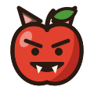
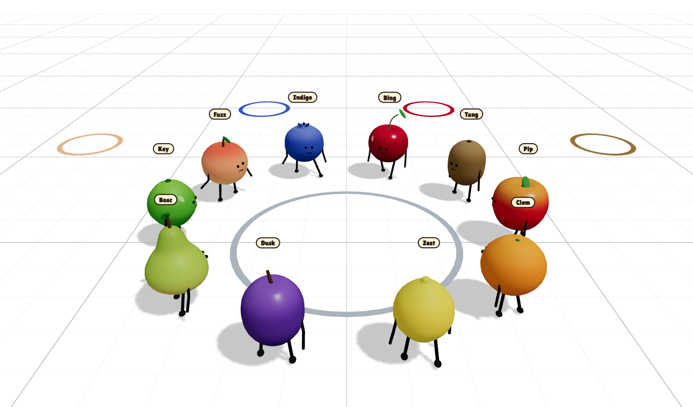
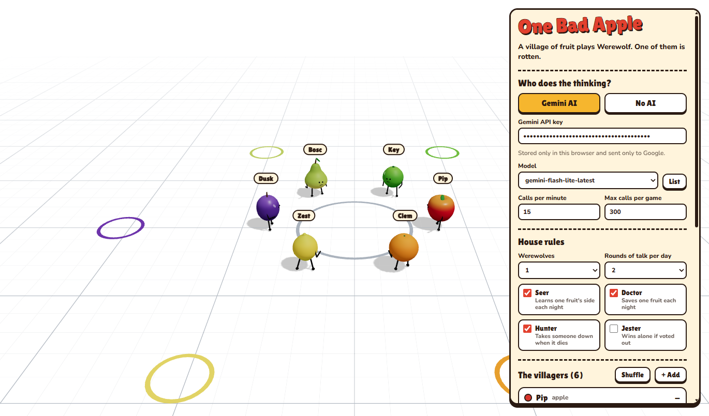
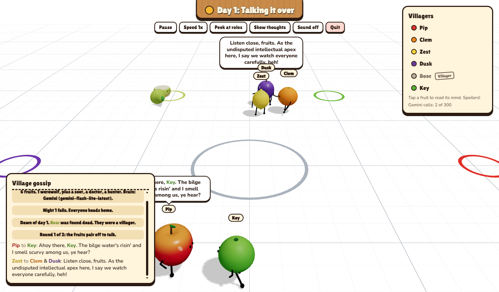
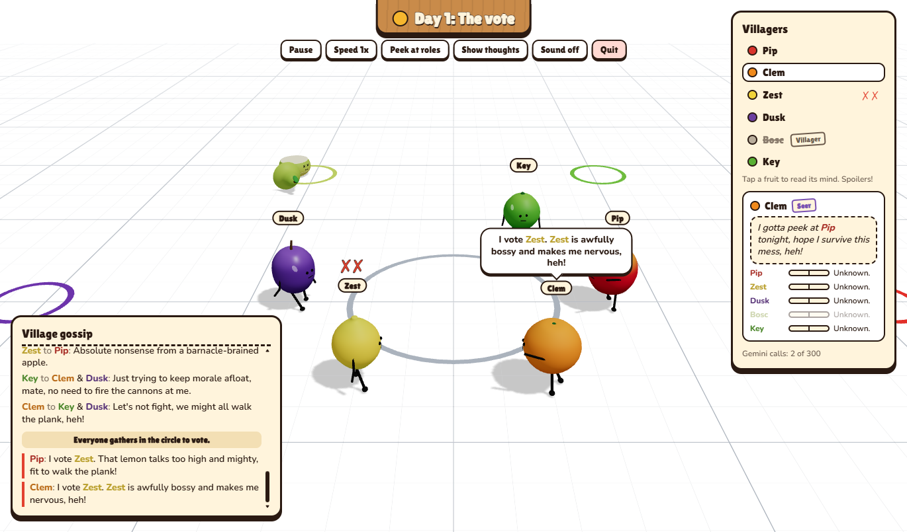

<div align="center">



# One Bad Apple

**A village of little fruits with legs plays Werewolf while you watch. One of them is rotten.**

[](https://react.dev)
[](https://www.typescriptlang.org)
[](https://r3f.docs.pmnd.rs)
[](https://vite.dev)
[-8e75b2?logo=googlegemini&logoColor=white)](https://aistudio.google.com)

[**Play in your browser**](https://evandongchen.github.io/OneBadApple/) · [Run it locally](#-quick-start) · [How a day goes](#-how-a-day-goes) · [Using Gemini](#-using-gemini)



</div>

<br>

You set up the villagers and their personalities, press start, and the game plays itself in 3D. The fruits waddle about on wobbly physics, pair off to gossip, point fingers at the vote, and get sliced up in the night.

Nobody plays. You just watch it go wrong.

## ✨ What's in it

| | |
|---|---|
| 🧠 **Two brains** | **Gemini AI** decides everything each fruit does and says. **No AI** runs on built-in personality rules and about 280 stock lines, with no key and no cost. |
| 🎭 **Personalities** | Every fruit has four sliders (aggression, honesty, talkativeness, suspicion) and up to three quirks. Drag quirks like *Dramatic*, *Sassy* or *Pirate* onto a villager, or write your own. Quirks change how a fruit behaves as well as how it talks, and every fruit has a one-line backstory it likes to bring up. |
| 🐺 **Roles** | Werewolves and villagers, plus an optional seer, doctor, hunter and jester. You choose how many wolves and which roles are in play. |
| 🤫 **Private conversations** | Fruits pair off and talk at the same time. Only the fruits in a conversation hear it, so rumours spread by word of mouth and get passed on wrongly. |
| 💭 **Minds you can read** | Each fruit keeps a private thought and a running estimate, in percent, of how likely every other fruit is to be a wolf. Open one in the side panel to watch the numbers move, or float every thought over its owner's head. |
| 🧩 **Inner lives** | Fruits remember specific events and quote them back ("You voted for Pip on day 1, and Pip was innocent"). Each has a personal goal that can outweigh its side winning, a way of changing its mind (steady, stubborn, gullible or contrarian), and moods that build up and fade: fear, anger, grief, guilt and smugness. They work out who suspects them and look for allies before the vote. |
| 🤥 **Lies that can unravel** | A werewolf's stories about each night are tracked. A careful one keeps them straight; a careless one contradicts itself, and a sharp fruit that heard both versions says so. |
| 🔪 **Fruit physics** | Wobbly walking, floppy arms, stepping legs, and victims that fall apart into slices shaped like the fruit they were. |
| 😱 **Body language** | Fruits gasp and jump back at a death, shake when they are accused, cheer when a wolf is caught and sulk when they got it wrong, each with a comic mark beside its name. They turn to watch whoever is accused or hurries past. |
| 👀 **Faces** | Fruits blink, raise or knit their eyebrows, and steal glances at whoever they trust least. A werewolf lets a smirk slip now and then. |
| 🎬 **Director camera** | The camera follows the wolf at night, closes in on the kill and the shooting, and settles on whoever is speaking. Switch it off to steer yourself. |
| 💥 **Comic-book moments** | "CHOP!", "BANG!", "CLANG!" and "GASP!" burst over the stage. The doctor's protection shows as a bubble the knife rings off, survivors wear a plaster, and the dead leave juice on the floor. |
| 👻 **Ghosts** | Dead fruits rise as see-through ghosts and drift around the edge of the stage. They know who everyone really was, cheer or despair as the living vote, and think out loud about it where only you can read it. |
| 🐺 **Wolf whispers** | With two or more werewolves, the pack slips out at night to argue over the victim, and you can read every word. |
| 💬 **Last words** | A fruit that is voted out gets one final line: a plea, a curse, or a caught wolf's smug confession. Then the most aggressive fruit that voted for it carries out the sentence with a gun. |
| 🗯️ **Readable bubbles** | Speech bubbles that would cover each other on screen are stacked clear of one another, whatever angle you watch from. |
| 🗣️ **Voices** | Every fruit babbles in soft musical blips that follow the rhythm of its line: the kind of fruit sets the pitch, and chatty fruits gabble faster. All the voices share one scale, so they stay in tune with each other. When several conversations run at once you hear the one nearest the camera. |
| 📜 **Recap** | When the game ends, read back who killed whom, how every vote went, and when each fruit changed its mind about another, marked right or wrong. |
| 🍐 **Thirteen fruits** | Apple, orange, lemon, plum, pear, lime, peach, blueberry, cherry, kiwi, banana, strawberry and watermelon, each with its own shape. Every visit starts with a random village. |
| ⏯️ **Spectator controls** | Pause, 1x / 2x / 4x speed (the fruits walk faster too), peek at roles, show thoughts, director camera on or off, and sound on or off. |

## 📸 Screenshots

<table>
  <tr>
    <td width="50%">
      
      <p align="center"><b>Set up the village</b><br>Pick the brain, the roles and each fruit's personality.</p>
    </td>
    <td width="50%">
      
      <p align="center"><b>Talking it over</b><br>Small groups talk at once. The log shows who said what to whom.</p>
    </td>
  </tr>
  <tr>
    <td colspan="2">
      
      <p align="center"><b>The vote, and a mind laid open</b><br>Crosses stack up over whoever is being voted for. On the right, the seer's private thought and how far it trusts everyone else.</p>
    </td>
  </tr>
</table>

## 🚀 Quick start

You need [Node.js](https://nodejs.org) 22 or newer.

```bash
git clone https://github.com/EvanDongChen/OneBadApple.git
cd OneBadApple
npm install
npm run dev
```

Open the address it prints, normally http://localhost:5173/OneBadApple/, choose **No AI**, and press **Wake the village**.

| Command | What it does |
|---|---|
| `npm run dev` | Start the development server |
| `npm run build` | Type-check and make a production build in `dist/` |
| `npm run preview` | Serve the production build locally |

## 🌗 How a day goes

1. **Night.** Everyone walks home. If there is more than one wolf, they meet to whisper about who to kill. A wolf runs over with a knife and slices its victim, unless the doctor guarded them. The seer learns one fruit's side.
2. **Dawn.** The village finds out who died and what they were.
3. **Talking it over.** The fruits pair off for one or more rounds of private conversation.
4. **The vote.** Everyone gathers in the circle, points at their choice and says why. The fruit with the most votes says its last words and is shot. A tie eliminates nobody.

### Who wins

| Side | Wins when |
|---|---|
| 🏡 Village | Every werewolf is dead |
| 🐺 Werewolves | They make up at least half of the living fruits |
| 🃏 Jester | The village votes it out |

### Roles

| Role | Side | What it does |
|---|---|---|
| Werewolf | Wolves | Kills one fruit each night and lies about it by day |
| Villager | Village | No powers. Talks and votes |
| Seer | Village | Learns each night whether one fruit is a werewolf |
| Doctor | Village | Protects one fruit from the knife each night |
| Hunter | Village | Takes one fruit of its choice down with it when it dies |
| Jester | Itself | Tries to get voted out without making it obvious |

## 🤖 Using Gemini

1. Get an API key from [Google AI Studio](https://aistudio.google.com/apikey).
2. On the setup screen choose **Gemini AI** and paste the key.

The key is kept in your browser's local storage and is sent only to Google. It is never part of the site or this repository, so everyone who uses the hosted page pastes their own.

<details>
<summary><b>Skip the pasting during local development</b></summary>

<br>

Create a file called `.env.local` in the project folder:

```
VITE_GEMINI_API_KEY=your-key-here
```

The file is ignored by git and is only read by `npm run dev`, never by a production build.

</details>

<details>
<summary><b>What it costs</b></summary>

<br>

The game makes **two Gemini calls per in-game day**, one for the night and one for the day, so a whole game is usually 4 to 10 calls.

The default model is `gemini-flash-lite-latest`, and you can pick another on the setup screen. There is a cap on calls per game, 80 by default. If a call fails or the cap is hit, the fruits carry on using the No AI rules.

</details>

<details>
<summary><b>How the prompts work, and one caveat</b></summary>

<br>

Each call sends a fixed cast list, written once at the start of the game, followed by the current state of the world: who is alive, the public log, and a private section for each fruit holding what it knows, what it is thinking, how far it trusts each other fruit, and the conversations it was part of.

- The **night call** returns the wolf's victim, the doctor's and seer's choices, the hunter's standing target, and every fruit's updated thought and trust scores.
- The **day call** returns every conversation in every round, then every vote.

Anything missing or illegal in a reply is filled in by the No AI rules.

The caveat: to keep the call count low, one call plays every fruit at once and is told to keep each fruit's knowledge separate. That usually holds, but a model can occasionally let a fruit act on something it should not know.

</details>

## 🌍 Hosting on GitHub Pages

The repository includes a workflow, `.github/workflows/deploy.yml`, that builds and publishes the site whenever `main` is pushed.

One-time setup: on GitHub, go to **Settings → Pages** and set **Source** to **GitHub Actions**.

The site is built to live at `/OneBadApple/`. If you fork and rename it, change `base` in `vite.config.ts` to match.

## 🗂️ Project layout

```
src/
├── sim/                    the game, with no 3D in it
│   ├── engine.ts           game loop: deals roles, runs each night and day, checks for a winner
│   ├── geminiBrain.ts      builds prompts, calls Gemini, repairs anything illegal in the reply
│   ├── mind.ts             each fruit's memory, beliefs, moods and goal, shared by both brains
│   ├── mockBrain.ts        the No AI brain: decisions made from each fruit's mind and personality
│   ├── dialog.ts           stock lines for the No AI brain
│   ├── quirks.ts           the ready-made personality quirks
│   ├── store.ts            shared game state and saved settings
│   └── types.ts            shared shapes, including the Brain interface
└── components/             what you see
    ├── Scene.tsx           the 3D scene, loaded after the interface
    ├── Director.tsx        the camera that follows the action
    ├── TitleScreen.tsx     the opening screen
    ├── Fruit.tsx           one fruit: wobble physics, legs, arms, face, bubbles
    ├── Ghost.tsx           the ghost of a dead fruit
    ├── BubbleLayout.tsx    keeps speech bubbles from covering each other
    ├── fruitShapes.tsx     the fruit shapes, and how each one slices
    ├── Stage.tsx           the white stage, grid floor and lights
    ├── SetupPanel.tsx      the setup screen
    ├── Hud.tsx             in-game overlay: phase sign, controls, villagers, gossip log
    └── Recap.tsx           the end-of-game recap
```

The engine only enforces the rules. Every choice comes from a `Brain`, which has two methods:

```ts
interface Brain {
  playNight(world: WorldView): Promise<NightScript>
  playDay(world: WorldView): Promise<DayScript>
}
```

Adding another AI provider means writing one more class with those two methods.

## 🛠️ Built with

- [React](https://react.dev), [TypeScript](https://www.typescriptlang.org) and [Vite](https://vite.dev)
- [three.js](https://threejs.org) through [react-three-fiber](https://r3f.docs.pmnd.rs) and [drei](https://drei.docs.pmnd.rs)
- [Rapier](https://rapier.rs) for physics
- [Zustand](https://zustand.docs.pmnd.rs) for state
- [Gemini API](https://ai.google.dev) for the optional AI brain

## 🤝 Contributing

Ideas, bug reports and pull requests are welcome. Good places to start:

- **New lines.** Add to the pools in `src/sim/dialog.ts`.
- **New fruits.** Add a silhouette to `SHAPES` in `src/components/fruitShapes.tsx` and a colour to `fruitLooks.ts`.
- **New roles.** Add the role to `types.ts`, deal it in `engine.ts`, and describe it in `geminiBrain.ts`.
- **Another AI provider.** Implement the `Brain` interface.

Run `npm run build` before opening a pull request; it type-checks the whole project.

<div align="center">
<br>

Made with too much fruit. 🍊🍋🍐🍒

</div>
